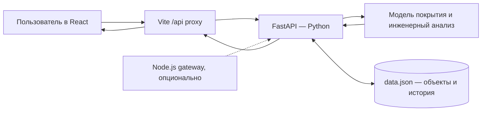

# Datark RF Guardian

**Цифровой прототип для предварительного проектирования и анализа радиопокрытия модульного центра обработки данных (МЦОД).**

Проект выполнен по кейсу №06 ООО «Датарк» — «Организация ретрансляции мобильной связи в модульный центр обработки данных». Приложение помогает сравнивать размещение внутренних антенн распределённой сотовой сети (DAS) и точек Wi‑Fi, оценивать расчётное покрытие помещений и формировать отчёт по выбранному объекту.

> **Статус:** исследовательский / хакатонный MVP. Это симулятор, а не работающий репитер, базовая станция, система управления передатчиками или заключение об электромагнитной совместимости (ЭМС). Измерений на объекте и проверки аварийных SMS приложением не выполняется.

## Возможности

| Раздел | Назначение |
| --- | --- |
| **Обзор** | Демонстрационная телеметрия RSSI/RSRP/SINR, состояние API и информация об отдельной GSM/SMS-линии. Телеметрия синтетическая. |
| **Карта покрытия** | Исходный PNG-план МЦОД, цветная расчётная heatmap, перетаскивание внутренних антенн/точек доступа, сценарии 2, 3 или произвольного числа точек (1–12). |
| **Анализ** | Доли покрытой площади, результаты по помещениям, параметры условного бюджета радиолинии и предупреждения о непроверенных рисках ЭМС. |
| **Документация** | Концепция внешнего RF-сегмента, фильтрации, репитера, DAS, независимого Wi‑Fi и сохранения штатного GSM/SMS-тракта; ссылка на схему draw.io. |
| **События и настройки** | История сохранённых изменений, параметры демонстрационного мониторинга. |
| **Объекты и отчёты** | Создание объекта как копии существующего, переключение объектов, сохранение расположения точек, TXT-отчёт по выбранному объекту и сохранённому сценарию. |

Для сотового сценария **число точек означает число внутренних панельных антенн в DAS, а не число независимых репитеров**. Для Wi‑Fi — количество AP. Реальные модели устройств, места монтажа и частоты выбираются после обследования.

## Принцип работы



Пользователь выбирает объект и конфигурацию, перемещает маркеры на плане; Python пересчитывает сетку условных уровней сигнала и статистику по комнатам. После сохранения координаты и параметры записываются в локальный JSON. Отдельный API формирует инженерный анализ и скачиваемый TXT-отчёт. Подробнее об алгоритмах, форматах запросов, настройке геометрии и структуре исходников — в [технической документации для разработчиков]([public/DEVELOPER_GUIDE.md](https://github.com/kiri-no-ha/Datark_RF_Guardian_MVP/blob/main/frontend/public/DEVELOPER_GUIDE.md)).

## Системные требования

| Компонент | Требование |
| --- | --- |
| ОС | Windows 10/11 (BAT-запуск); Linux/macOS — ручной запуск через терминал |
| Python | 3.10+; рекомендуется Python 3.11–3.13 с `pip` и `venv` |
| Node.js | Рекомендуется актуальная LTS-версия Node.js 20+ вместе с npm |
| Браузер | Современный Chrome, Edge, Firefox или аналог с поддержкой Canvas и Pointer Events |
| Сеть | Интернет нужен для первичной установки зависимостей; после установки вычисления работают локально |
| Оборудование RF | Для демонстрации не требуется: расчёты и показания симулируются |

Порты по умолчанию: **5173** (UI), **8000** (API), **3001** (необязательный Node.js gateway). Для работы API и UI эти порты должны быть свободны.

## Установка и запуск

### Способ 1 — Windows, через BAT

1. Установите Python и Node.js с npm. Проверьте их доступность: `py --version`, `node --version`, `npm --version`.
2. Скачайте исходники репозитория и распакуйте их. Откройте папку, где находятся `frontend/`, `rf-engine/` и `start_datark.bat`.
3. Запустите **`start_datark.bat`** двойным щелчком или из PowerShell: `./start_datark.bat`.
4. При первом запуске скрипт создаёт Python-окружение и устанавливает необходимые пакеты; при обычных следующих запусках готовые зависимости повторно не скачиваются.
5. Откройте [http://127.0.0.1:5173](http://127.0.0.1:5173). Документация API: [http://127.0.0.1:8000/docs](http://127.0.0.1:8000/docs).

Для принудительной переустановки зависимостей: `./start_datark.bat --install`.

> Если BAT отсутствует в вашей сборке или не запускается, используйте ручной способ ниже. Команды запускают два отдельных процесса, оба должны оставаться работающими.

### Способ 2 — ручной (два терминала)

**Терминал 1 — backend:**

```powershell
cd rf-engine
py -m venv .venv
.\.venv\Scripts\python.exe -m pip install -r requirements.txt
.\.venv\Scripts\python.exe -m uvicorn main:app --host 127.0.0.1 --port 8000
```

**Терминал 2 — frontend** (из корня проекта):

```powershell
cd frontend
npm install
npm run dev
```

Для Linux/macOS используйте `python3 -m venv .venv`, `./.venv/bin/python` и `npm run dev`.

### Сборка frontend

```powershell
cd frontend
npm run build
```

Скомпилированные статические файлы появляются в `frontend/dist/`. Отдельный production-хостинг API/статики проектом не настроен: описанный запуск — локальный режим разработки/демонстрации.

## Типовой сценарий

1. Откройте **«Карта покрытия»** и выберите LTE/DAS либо Wi‑Fi.
2. Сравните два, три или собственное количество точек; оцените покрытие трёх помещений.
3. Перетащите маркеры внутри размеченных зон и дождитесь предварительного пересчёта.
4. Нажмите **«Сохранить позиции»** — только после этого изменения записаны в `rf-engine/data.json`.
5. Откройте **«Анализ»** для сохранённого сценария; просмотрите показатели и непроверенные риски.
6. Нажмите **«Сформировать отчёт TXT»** в боковой панели — файл содержит данные выбранного объекта и *сохранённого* сценария.
7. Чтобы создать другой объект, введите его имя в боковом меню и нажмите `+`. Новый объект создаётся как **копия текущего**, включая конфигурацию.

## Какие данные используются

- План: `frontend/public/plan.png`, габариты здания по чертежу около **14 × 9 м**, общая площадь помещений **124,7 м²**.
- Помещения: аппаратный зал **84,8 м²**, энергомодуль **29,8 м²**, технологический тамбур **10,1 м²**.
- Контуры стен/стоек оцифрованы **приблизительно**, в процентных координатах исходного изображения; точный CAD/3D-проект не используется.
- Для LTE/DAS используются заданные уровни донорного сигнала, усиление репитера и потери; для Wi‑Fi — заданный EIRP и условная модель 2,4 ГГц.
- Цветовые зоны и проценты покрытия — **результат расчёта**, а не реальные замеры. Статус существующей аварийной GSM/SMS-линии — **не отслеживается**.

## Структура репозитория

```text
.
├── README.md                      # Назначение проекта и запуск
├── start_datark.bat               # Windows: установка и запуск
├── frontend/
│   ├── public/
│   │   ├── plan.png              # Исходный чертёж
│   │   ├── hardware-architecture.drawio  # Схема, если установлен патч документации
│   │   └── DEVELOPER_GUIDE.md    # Подробная документация (этот комплект)
│   ├── src/                      # React, карта, анализ, стили, API-клиент
│   └── package.json
├── rf-engine/
│   ├── main.py                   # FastAPI endpoints
│   ├── coverage.py               # Модель радиопокрытия
│   ├── analysis.py               # Расчётный анализ и TXT-отчёт
│   ├── storage.py                # JSON-хранилище
│   ├── requirements.txt
│   └── tests/
├── gateway/server.mjs            # Node.js-прокси (необязателен)
└── docs/                         # Схемы и описание аппаратной концепции
```

## Проверка работоспособности

```powershell
cd rf-engine
py -m pytest -q
```

Открыть [`/api/health`](http://127.0.0.1:8000/api/health): ожидается `status: "ok"`, `mode: "simulation"`. Для ручной проверки используйте Swagger (`/docs`). Если при запуске видите «Нет ответа API», убедитесь, что Python запущен и порт 8000 свободен.

## Ограничения и безопасность

- Приложение не включает передающее радиоустройство, не управляет реальным репитером и не обеспечивает физически мобильную связь или Wi‑Fi само по себе.
- Отсутствие интерференции GSM, PIM/IMD, корректность uplink/downlink и стабильность аварийных SMS **не доказаны**. GSM-модем нельзя изменять согласно условиям кейса.
- Wi-Fi Calling зависит от поддерживаемого оператора, смартфона и доступа к сети.
- Файл `rf-engine/data.json` хранит локальные пользовательские объекты; обычно он исключается из Git. Новая установка получает стартовый объект из `storage.py`.
- FastAPI/JSON-хранилище не предназначены для открытой публикации в интернет без авторизации, управления доступом и дополнительной защиты.

## Документация

**[Техническое описание для разработчиков — архитектура, API, расчётная модель, хранение данных и расширение проекта](public/DEVELOPER_GUIDE.md)**

Дополнительно: при наличии файла `docs/hardware-architecture.drawio` его можно открыть в [diagrams.net](https://app.diagrams.net/). Электрическая и RF-монтажная схема для действующего оборудования потребует отдельного проектирования и согласования.
