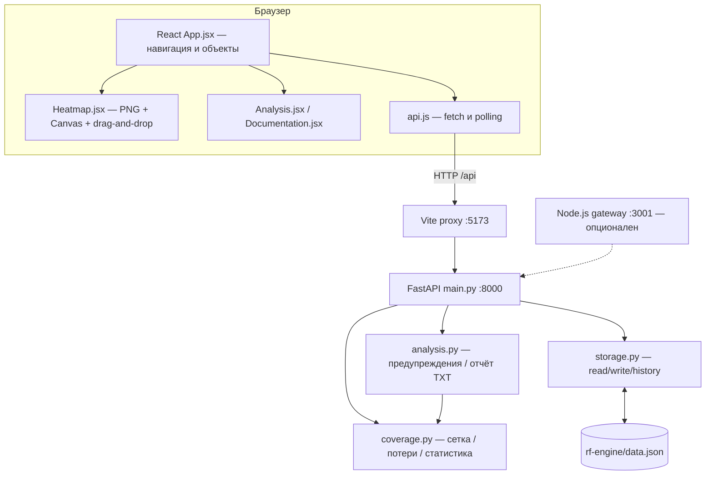

# Datark RF Guardian — техническая документация для разработчиков

**Назначение:** описать состав модулей, потоки данных, форматы объектов, математическую модель, HTTP API, жизненный цикл сценариев и правила безопасного расширения MVP. Документ относится к сборке с React/Vite, Python/FastAPI, экраном «Анализ», TXT-отчётом и пользовательским сценарием `custom`.

[← Вернуться к основному README](../README.md)

> **Граница ответственности:** здесь описывается **симулятор проектирования**. Показатели RF и карта — вычисленные значения; реальная телеметрия устройств не собирается, передатчики не подключены, SMS не отправляются. Указанные предупреждения об ЭМС — напоминания о необходимых проверках, а не измеренная оценка PIM/IMD.

## 1. Архитектура приложения



**Основной исполняемый путь:** `frontend → Vite proxy → FastAPI → Python-модули`. Node.js в `gateway/server.mjs` — дополнительный прокси без внешних npm-зависимостей, **не обязательный backend**. Наличие папки `gateway/` не означает, что сервис всегда запущен.

### Каталоги и ответственность

| Путь | Что содержит / за что отвечает |
| --- | --- |
| `frontend/src/main.jsx` | Точка входа React, монтаж приложения в DOM. |
| `frontend/src/App.jsx` | Каркас UI, навигация, выбор/создание объектов, режим и сценарий, карта, обработка кнопки TXT-отчёта. |
| `frontend/src/Heatmap.jsx` | PNG-подложка, `<canvas>` с расчётной тепловой картой, геометрические наложения и перетаскивание маркеров Pointer Events. |
| `frontend/src/Graph.jsx` | График синтетической временной серии. |
| `frontend/src/Analysis.jsx` | Таблицы и предупреждения инженерного анализа по сохранённому сценарию. |
| `frontend/src/Documentation.jsx` | Концепция аппаратной системы и контрольные требования. |
| `frontend/src/api.js` | Общий `fetch('/api' + path)`, обработка ошибок, polling через `usePoll`. |
| `frontend/src/styles.css`, `analysis.css` | Основная тема и стили анализа/документации, в последних патчах — адаптивность. |
| `frontend/public/plan.png` | Исходная PNG-схема объекта, обслуживается по адресу `/plan.png`. |
| `rf-engine/main.py` | REST-методы FastAPI, валидация входных данных через Pydantic и orchestration вычислений. |
| `rf-engine/coverage.py` | Геометрия объекта, расчёт уровней, сетка покрытия и статистика по помещениям. |
| `rf-engine/analysis.py` | Сводный анализ, условный бюджет тракта, предупреждения и форматирование TXT. |
| `rf-engine/storage.py` | Начальные данные, чтение/запись JSON, история изменений. |
| `rf-engine/tests/` | Автоматические проверки API и расчётных сценариев. |
| `gateway/server.mjs` | Опциональный Node.js HTTP-прокси на 3001 → FastAPI на 8000. |

Реализация frontend — **React на JavaScript/JSX**, а не полноценный TypeScript-проект. Приложение не использует PostgreSQL, Prisma или NestJS в текущей версии.

## 2. Доменная модель

### 2.1. Объект (layout)

Основная сущность — *объект МЦОД*, выбираемый в боковом меню. Он хранит имя, идентификатор, путь к плану, параметры упрощённого расчёта и положения внутренних точек для каждого сценария.

Пример структуры (значения иллюстративные):

```json
{
  "id": "mcod-1",
  "name": "МЦОД Екатеринбург",
  "plan": "/plan.png",
  "gain": 60,
  "donor_dbm": -86,
  "feed_loss": 6,
  "clutter": 4,
  "wifi_eirp_dbm": 17,
  "positions": {
    "cellular": {
      "two": [{"id":"C1","name":"Панель 1","x":27,"y":60}, {"id":"C2","name":"Панель 2","x":60,"y":60}],
      "three": [],
      "custom": []
    },
    "wifi": {
      "two": [{"id":"W1","name":"Wi-Fi AP 1","x":27,"y":60}, {"id":"W2","name":"Wi-Fi AP 2","x":62,"y":60}],
      "three": []
    }
  }
}
```

Это **схема**, не готовый seed-файл: в реальном `storage.py` массивы `three` заполнены, а `custom` создаётся после первого сохранения пользовательского сценария. Не подменяйте дефолтные данные приведённым сокращённым JSON.

- `technology`: `cellular` (LTE/DAS) или `wifi` (точки Wi-Fi).
- `scenario`: `two`, `three`, `custom` (если сохранён).
- `positions[technology][scenario]`: список внутренних точек `{id,name,x,y}`.
- `x`, `y`: **проценты ширины/высоты исходного изображения**, диапазон 0–100; это не метры и не пиксели.
- `gain`: модельное усиление репитера, dB; `donor_dbm`: условный внешний входной сигнал, dBm.
- `feed_loss`: условные потери кабельного тракта, dB; `clutter`: дополнительное затухание на стойках/трассе, dB.
- `wifi_eirp_dbm`: модельный EIRP точки доступа, dBm.

### 2.2. Создание объекта и хранение

`POST /api/layouts` принимает название и ID `copy_from`; реализация выполняет `deepcopy` выбранного объекта, присваивает новый короткий ID и записывает результат в JSON. Это **клонирование конфигурации**, а не создание пустой планировки с произвольной геометрией.

Хранилище — `rf-engine/data.json` с корневыми ключами `layouts`, `history`, `config`. При отсутствии файла `storage.py` создаёт состояние по `default_db()`. История хранит до **500 последних событий**. Для записи применяется временный `.tmp` и замена файла; есть внутрипроцессный `RLock`.

**Ограничение:** JSON-хранилище рассчитано на локальный MVP. Это не полноценная многопользовательская БД: нет учётных записей, транзакционного конкурентного редактирования между процессами, пользовательских прав и резервного копирования.

Для сброса данных: остановить API → сделать резервную копию `rf-engine/data.json` (если она нужна) → удалить файл → снова запустить API. Не удаляйте данные во время работы сервера.

## 3. Как рассчитывается покрытие

### 3.1. Геометрия помещения

Геометрия задаётся константами в `rf-engine/coverage.py`:

- `IMAGE_SIZE = (1724, 1017)` — размер исходной PNG-подложки.
- `BUILDING = (7.5, 6.0, 77.5, 92.5)` — примерный прямоугольник здания на *полном* изображении, в процентах.
- `AREAS` — три расчётных прямоугольника (аппаратный зал, энергомодуль, тамбур) и их площади.
- `WALLS` — упрощённые разделительные перегородки.
- `RACK_ROWS` — две приближённые полосы серверных стоек.
- `THRESHOLDS` — пороги качества и частота модели для LTE и Wi-Fi.

Эта разметка получена **приблизительно по PNG**, включая поля и легенду справа. Для точного моделирования необходимо отдельно калибровать координаты, стены, высоты, материалы и диаграммы направленности.

### 3.2. Расчёт точки

Для каждой точки расчётной сетки определяется уровень от каждого размещённого источника, затем выбирается **наибольший** из полученных уровней. Это упрощение: суммирование электрических полей, интерференция, MIMO, multi-AP scheduling и полная RF-модель отсутствуют.

Примерно реализованы следующие вычисления:

```text
distance_m = max(1, расстояние от антенны до точки в пересчёте 14 × 9 м)
FSPL_1m = 32.44 + 20*log10(freq_MHz) - 60
path_loss = FSPL_1m + 10*n*log10(distance_m)
          + штрафы за пересечённые стены
          + штрафы за пересечённые ряды стоек
          + дополнительные поправки
level_dbm = model_eirp_dbm - path_loss
result = max(level_dbm по всем внутренним точкам)
```

При этом `n = 2.25` в режиме cellular и `n = 3.15` в режиме Wi-Fi. Модель использует частоты **2600 МГц для cellular** и **2400 МГц для Wi-Fi**. Типовые коэффициенты затухания в коде: стена **10 dB** (cellular) / **17 dB** (Wi-Fi), пересечение ряда стоек **4 dB** / **9 dB** соответственно; в режиме Wi-Fi дополнительно заложено **7 dB** на плотное оборудование. Это **предположения прототипа**, а не измеренные свойства конкретного здания.

Модельный уровень на ветвь для DAS:

```text
EIRP_branch = donor_dbm + 9 - feed_loss + gain + 5 - 10*log10(N)
```

Здесь `9 dBi` и `5 dBi` — фиксированные допущения усиления внешней/внутренней антенн, `N` — число внутренних панелей. В физическом тракте также учитываются реальные делители, ответвители, кабели, согласование, UL/DL и ограничения мощности; **формула MVP не является полным бюджетом радиолинии**.

### 3.3. Расчётная сетка и выход

По умолчанию `calculate()` формирует **84 столбца × 51 строку**. Вне моделируемых комнат ячейка имеет `null`. Для каждой комнаты формируются среднее, минимум и доля ячеек выше выбранного порога; в сводке — проценты `good_pct`, `covered_pct`, `weak_pct` и число рассчитанных ячеек `sampled_cells`.

Пороги из `THRESHOLDS`:

| Режим | Хорошо | Приемлемо | Условная частота |
| --- | ---: | ---: | ---: |
| cellular | ≥ −82 dBm | ≥ −98 dBm | 2600 МГц |
| wifi | ≥ −67 dBm | ≥ −80 dBm | 2400 МГц |

Эти значения относятся к **условному модельному уровню**, а не к измеренному RSRP LTE. Нельзя автоматически сравнивать их с нормативным качеством оператора или использовать как критерий приёмки реального объекта.

### 3.4. Визуализация карты

`Heatmap.jsx` накладывает `<canvas>` поверх неизменяемого `plan.png`, окрашивает сетку по порогам и рисует HTML-кнопки-маркеры. События `pointerdown/move/up` передают новые координаты в `App.jsx`. Перемещение ограничено прямоугольниками расчётных комнат.

На карте предусмотрены отображение стен/стоек, подписей и масштабирование. Перетаскивание **не записывает** координаты сразу в базу: сначала выполняется `POST /coverage/preview` с debounce около **250 мс**, далее после кнопки «Сохранить позиции» выполняется `PUT /positions`.

## 4. API FastAPI

Базовый URL при локальном запуске: `http://127.0.0.1:8000`. Во frontend относительные запросы идут на `/api/...`; Vite перенаправляет их по `frontend/vite.config.js`.

| Метод | Путь | Назначение |
| --- | --- | --- |
| `GET` | `/api/health` | Статус API, режим симуляции и неподключённая GSM/SMS-линия. |
| `GET` | `/api/layouts` | Список ID и названий объектов. |
| `GET` | `/api/layouts/{lid}` | Полная конфигурация объекта. |
| `POST` | `/api/layouts` | Создать копию объекта `{name, copy_from}`. |
| `PUT` | `/api/layouts/{lid}` | Обновить модельные параметры RF/Wi-Fi (все поля `Settings`). |
| `PUT` | `/api/layouts/{lid}/positions` | Сохранить расположение точек в выбранном режиме/сценарии. |
| `GET` | `/api/layouts/{lid}/coverage` | Расчёт по **сохранённому** сценарию. |
| `POST` | `/api/layouts/{lid}/coverage/preview` | Пересчитать временные позиции **без записи**. |
| `GET` | `/api/layouts/{lid}/compare` | Сравнить доступные сохранённые сценарии `two`, `three`, `custom`. |
| `GET` | `/api/layouts/{lid}/analysis` | Сводный инженерный анализ (предупреждения и расчётный бюджет). |
| `GET` | `/api/layouts/{lid}/report` | Сформировать `text/plain` TXT-отчёт с UTF-8 BOM для Excel/Windows-совместимости. |
| `GET` | `/api/layouts/{lid}/telemetry` | Синтетические RSSI/RSRP/SINR, режим SMS `unmonitored`. |
| `GET` | `/api/layouts/{lid}/series` | Синтетическая временная серия с параметрами `metric`, `minutes`, `step`. |
| `GET` | `/api/history` | Журнал; необязательные `layout`, `limit`. |
| `GET`/`PUT` | `/api/config` | Демонстрационные настройки мониторинга. |

### Примеры запросов

**Создать объект:**

```powershell
$body = @{ name = 'МЦОД — тестовая копия'; copy_from = 'mcod-1' } | ConvertTo-Json
Invoke-RestMethod -Uri 'http://127.0.0.1:8000/api/layouts' -Method Post -ContentType 'application/json' -Body ([System.Text.Encoding]::UTF8.GetBytes($body))
```

**Получить карту по сохранённым двум панелям:**

```text
GET /api/layouts/mcod-1/coverage?technology=cellular&scenario=two
```

**Пересчитать без сохранения:**

```json
POST /api/layouts/mcod-1/coverage/preview
{
  "technology": "wifi",
  "scenario": "two",
  "antennas": [
    {"id": "W1", "name": "Wi-Fi AP 1", "x": 26, "y": 61},
    {"id": "W2", "name": "Wi-Fi AP 2", "x": 58, "y": 60}
  ]
}
```

**Сохранить изменённые координаты:** тот же JSON, но `PUT /api/layouts/mcod-1/positions`.

**Получить анализ и TXT:**

```text
GET /api/layouts/mcod-1/analysis?technology=cellular&scenario=three
GET /api/layouts/mcod-1/report?technology=cellular&scenario=three
```

Схемы запросов и ответы можно исследовать в Swagger UI: `http://127.0.0.1:8000/docs` или `/openapi.json`.

### Валидация и ошибки

- `Position.x/y`: от 0 до 100; дополнительно проверяется размещение внутри одной из модельных комнат (`zone_of`).
- `two`: ровно 2 точки; `three`: ровно 3; `custom`: **1–12**.
- ID точек в одном сценарии должны быть уникальны.
- Для неподдерживаемого режима/сценария возвращается **422**.
- При неизвестном ID объекта — **404**.
- Для `custom` без сохранённой конфигурации `/coverage`, `/analysis`, `/report` возвращают **404**; интерфейс не должен незаметно подменять пользовательский сценарий стандартным.
- `Settings`: `gain` 0–65, `donor_dbm` −120…−40, `feed_loss` 0–40, `clutter` 0–25, `wifi_eirp_dbm` −10…25.

**Важно:** `PUT /api/layouts/{lid}` использует модель `Settings` с полным набором полей; при программном вызове передавайте все текущие значения, даже если меняете одно.

## 5. Страница «Анализ» и экспорт отчёта

`analysis.py` вызывает ту же `calculate()`, что обслуживает карту. Дополнительно собираются условные значения бюджета, предупреждения о слабом покрытии, высокой настройке усиления, недостаточности фактических RF-данных и неподтверждённой работе SMS.

**Не реализовано:** измерение PIM/IMD, реальная частотная селективность фильтров по S-параметрам, подтверждение стабильности RF-репитера, сертификация ЭМС, реальное получение RSRP или мониторинг GSM-модема. Анализ **не должен называться доказательством отсутствия помех**.

Отчёт (`/report`) использует **только сохранённые** координаты, поэтому после перетаскивания точек необходимо сначала нажать «Сохранить позиции». Формируется `.txt` с названием объекта, временем, выбранным сценарием, статистикой зон, координатами, параметрами, аппаратной концепцией и ограничениями расчётов. Файл генерируется на сервере и скачивается браузером — не сохраняется постоянно в `rf-engine/reports/`.

## 6. Аппаратная концепция и GSM/SMS

Техническая схема — **проектное допущение**, а не подключённая аппаратная система:

```text
БС оператора ⇄ донорная направленная антенна
              ⇄ фильтры / дуплексер / RF-защита
              ⇄ репитер с управлением усилением (DL и UL)
              ⇄ делители / ответвители DAS
              ⇄ внутренние панельные антенны ⇄ телефоны

ЛВС / интернет → PoE-коммутатор → Wi‑Fi AP ⇄ телефоны

Существующая GSM-антенна ⇄ GSM-модем → аварийные SMS
(существующий тракт остаётся отдельно; не перенастраивается)
```

Проверки перед реальным внедрением: рабочие полосы операторов, разрешённое использование RF-оборудования, донорный сигнал, изоляция донорной/внутренних антенн, уровни мощности/шум, UL/DL, совместимость с GSM 900/1800, PIM/IMD, тест SMS до и после монтажа. Примерная блок-схема находится в `docs/hardware-architecture.drawio`, если включена в сборку.

## 7. Тесты, разработка и диагностика

**API и расчёты:**

```powershell
cd rf-engine
py -m pip install -r requirements.txt
py -m pytest -q
```

**Frontend:**

```powershell
cd frontend
npm install
npm run build
```

В коде frontend также используются `localStorage` для настройки темы и, возможно, других UI-предпочтений. Источник истины для сохранённых схем — JSON на сервере, не localStorage.

Типовые проблемы:

| Симптом | Причина / проверка |
| --- | --- |
| «Нет ответа API» | Не запущен `uvicorn`, занят порт 8000 или Vite proxy направлен не туда. |
| Невозможно сохранить точку | Маркер оказался вне допустимого прямоугольника комнаты; API отвечает 422. |
| После перезагрузки изменения пропали | Не нажали «Сохранить позиции»; предварительный расчёт не сохраняется. |
| `custom` не открывается в анализе | Сценарий ещё не сохранён; вернитесь на карту. |
| Не появляется план | Проверить `frontend/public/plan.png` и путь `/plan.png`. |
| Ошибка импорта `analysis` | Файл `rf-engine/analysis.py` отсутствует или патч установлен не полностью. |
| Пустой список объектов | Проверить API `/api/layouts` и целостность `rf-engine/data.json`. |
| Неправильное отображение при масштабе | Проверить наличие последнего `analysis.css` и общих responsive-стилей. |

### Как добавить новую физику/сценарий

1. **Геометрия:** изменять `AREAS`, `WALLS`, `RACK_ROWS` и физический масштаб в `coverage.py`; визуальные контуры в `Heatmap.jsx` синхронизировать вручную. Сейчас геометрия продублирована в Python и JSX.
2. **Новый диапазон:** расширять `THRESHOLDS`, частотные параметры и модели потерь; не обещать физическую точность без калибровки.
3. **Реальный датчик/SDR:** вводить явный атрибут `source: device` и отдельный адаптер; не смешивать измеренные показатели с `source: simulation`.
4. **Новая визуализация:** добавить React-компонент, использовать `api.js` и типизированный по смыслу JSON-контракт; не изменять серверную модель через DOM напрямую.
5. **Несколько операторов/полос:** хранить конфигурацию диапазонов явно в объекте и отдельно моделировать UL/DL, потери, развязку, линейность и ЭМС.
6. **Продакшен:** заменить файловое хранилище БД, внедрить авторизацию/аудит, тестирование concurrency, управление секретами и TLS, вынести конфигурацию в переменные окружения.

## 8. Безопасность и реальные ограничения

API ориентирован на локальное применение. Нет аутентификации; нельзя выставлять порт 8000 в публичный интернет без защиты. `CORSMiddleware` допускает локальный Vite; сам факт ограниченного CORS **не заменяет аутентификацию**. Файлы `data.json`, `.venv`, `node_modules` и кэши обычно исключаются из Git.

Исходный кейс запрещает демонтаж и перенастройку существующей GSM-антенны и модема. Репитер/антенны/фильтры в прототипе — **расчётные элементы**. Переход к физическому монтажу требует обследования, реальных спецификаций, согласования использования диапазонов и лабораторных/натурных испытаний ЭМС.

---

**Содержание документа соответствует исследованной сборке MVP с патчами анализа и адаптивности.** Если структура проекта после этого изменяется, актуализируйте пути, API и формулы одновременно с кодом.
